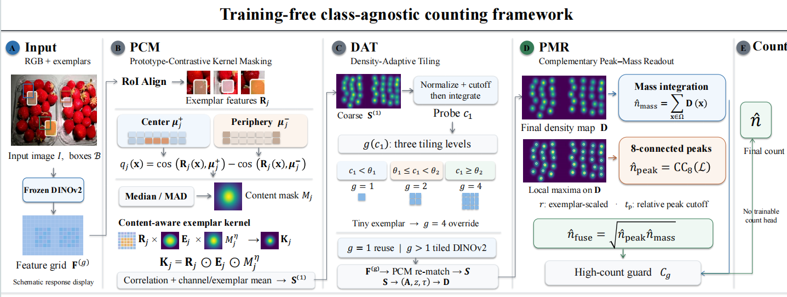

# Complementary Peak–Mass Readout for Training-Free Class-Agnostic Counting

Reference code for the paper **“Complementary Peak–Mass Readout for Training-Free
Class-Agnostic Counting.”** It reproduces the two headline results of the paper:

| Dataset | Configuration | MAE | RMSE |
|---|---|---|---|
| FSC-147, validation | PCM + DAT + PMR | **17.93** | **47.61** |
| FSC-147, test | PCM + DAT + PMR | **18.09** | **61.28** |
| CARPK, test | PCM + DAT + PMR (FSC-147 thresholds, no CARPK tuning) | **13.8546** | **19.8040** |

Nothing is trained: the backbone is frozen, the exemplar kernels are built from
its features at run time, and the only fitted quantities are eight scalars
selected once on FSC-147 validation.



*PCM weights each exemplar kernel by central–peripheral feature contrast; DAT
routes an image to 1×/2×/4× tiling from a coarse integral probe; PMR converts the
resulting response map into a count by fusing response mass with local-peak
multiplicity, with a high-count guard.*

---

## 1. What this repository contains

```
PMR_Release/
├── pmr/                     reference implementation (importable package)
│   ├── config.py            frozen scalars reported in the paper
│   ├── backend.py           adapter to the CountingDINO reference code
│   ├── pcm.py               Prototype–Contrastive Kernel Masking
│   ├── response.py          response construction + calibration
│   ├── readout.py           Complementary Peak–Mass Readout
│   ├── dat.py               Density-Adaptive Tiling
│   ├── dumps.py             readers for the dumped responses / peak counts
│   ├── metrics.py           MAE / RMSE / bootstrap / Wilcoxon
│   └── geometry.py          token-grid region helper
├── tools/
│   ├── dump_responses.py    GPU: response maps + mass statistics
│   ├── dump_peak_counts.py  CPU: peak statistic over the (beta, t_peak) grid
│   ├── eval_fsc147.py       CPU: tune DAT on val, freeze, report test
│   ├── eval_carpk.py        CPU: report CARPK test with frozen settings
│   └── selftest_pmr.py      CPU: synthetic sanity check, no data needed
├── scripts/
│   ├── reproduce_fsc147.sh  end-to-end FSC-147
│   └── reproduce_carpk.sh   end-to-end CARPK
├── docs/
│   ├── DATA.md              dataset download and layout
│   └── REPRO_NOTES.md       protocol details and expected intermediate values
├── figures/framework.png
├── requirements.txt
└── README.md
```

**Not included** (by design): the FSC-147 and CARPK images and annotations, the
DINOv2 weights, and the numerical tables of the other rows of the paper. The code
here regenerates only the three rows above.

---

## 2. Environment

```bash
conda create -n pmr python=3.10 -y
conda activate pmr
pip install -r requirements.txt
```

The reference runs used Linux, PyTorch 2.x and a single 24 GB GPU, where the GPU
dump peaks at about 14 GB of VRAM. Python 3.9+ is required; the evaluation steps
run on CPU.

### Code dependency: CountingDINO

The frozen DINOv2 backbone, the tiled feature extraction (`get_features`) and the
response rescaling follow the CountingDINO reference implementation. **Clone it
next to this repository** — its source is imported, not copied, so the backbone
behaves exactly as in the original code:

```bash
git clone https://github.com/lorebianchi98/CountingDINO.git third_party/CountingDINO
export COUNTINGDINO_ROOT=$PWD/third_party/CountingDINO
export PYTHONPATH=$COUNTINGDINO_ROOT:$PWD:$PYTHONPATH
```

No trained CountingDINO checkpoint is needed. This method builds every kernel
from frozen DINOv2 features, so `dinov2_vitl14_reg` is fetched by `torch.hub` on
first use (≈1.2 GB, cached in `~/.cache/torch`).

---

## 3. Data

The datasets are **not** redistributed here; download them from their official
sources and point the scripts at them with environment variables. Details and a
download checklist are in [`docs/DATA.md`](docs/DATA.md).

```bash
export FSC147_ROOT=/path/to/FSC147            # see docs/DATA.md for the expected layout
export CARPK_ROOT=/path/to/CARPK
```

Expected layout:

```
$FSC147_ROOT/
├── images_384_VarV2/                        # 6,135 images
├── annotation_FSC147_384.json               # points + exemplar boxes
├── Train_Test_Val_FSC_147.json              # split lists
└── gt_density_map_adaptive_384_VarV2/       # official density maps (*.npy), optional
                                             #   needed for the 17.93 / 47.61 row

$CARPK_ROOT/
├── images/                                  # 1,448 images
├── annotation_CARPK_3exemplars_11seed_5threshold.json
└── splits_carpk.json                        # {"train": [...989...], "test": [...459...]}
```

Both annotation files use the FSC-147 JSON format: per image, `points` (one per
instance) and `box_examples_coordinates` (the exemplar boxes). Any path can be
overridden on the command line (`--data-root`, `--annotation`, `--splits`).

---

## 4. Reproducing the results

### 4.1 FSC-147 (GPU dump, then CPU evaluation)

```bash
bash scripts/reproduce_fsc147.sh
```

The script does three things, per split (`val`, `test`) and per tiling level
(4×, 2×, 1×):

1. `tools/dump_responses.py` — PCM kernel, calibrated response, mass statistic,
   `box_r`, and the saved response map;
2. `tools/dump_peak_counts.py` — peak statistic over the (beta, t_peak) grid;
3. `tools/eval_fsc147.py` — selects (θ₁, θ₂) on validation, freezes it, reports
   validation and test.

To run the steps by hand (4× level shown; use `_2x` / `_1x` and `--divide 1` / `0`
for the other levels):

```bash
python tools/dump_responses.py --split val --divide 2 \
    --data-root $FSC147_ROOT/images_384_VarV2 \
    --annotation $FSC147_ROOT/annotation_FSC147_384.json \
    --splits    $FSC147_ROOT/Train_Test_Val_FSC_147.json \
    --density-dir $FSC147_ROOT/gt_density_map_adaptive_384_VarV2 \
    --out outputs/fsc147/readout_pcm05_val.json \
    --maps-out outputs/fsc147/maps_pcm05_val.npz

python tools/dump_peak_counts.py \
    --records outputs/fsc147/readout_pcm05_val.json \
    --maps    outputs/fsc147/maps_pcm05_val.npz \
    --out     outputs/fsc147/dar_counts_pcm_val.npz

python tools/eval_fsc147.py --dump-dir outputs/fsc147
```

### 4.2 CARPK (GPU dump, then CPU evaluation)

```bash
bash scripts/reproduce_carpk.sh
```

Same three steps for the CARPK test split with `--min-gt 1`. Nothing is tuned on
CARPK: `tools/eval_carpk.py` applies the thresholds selected on FSC-147
validation, exactly as in the paper.

---

## 5. Expected output

`tools/eval_fsc147.py` prints (numbers reproduced from the released code):

```
validation grid: minimum 17.6533 at (15, 32); plateau(<=+0.02) = 10 pairs
selected on validation: (15, 31) -> MAE 17.6697

VAL  n=1286  tiling 1x/2x/4x = 257/514/515  mean tiles 9.01
  DAT, integral readout   MAE  21.5431  RMSE  51.8937
  PCM + DAT + PMR         MAE  17.6697  RMSE  45.6530
  PCM + DAT + PMR, density-map GT   MAE  17.9271  RMSE  47.6082

TEST  n=1190  tiling 1x/2x/4x = 184/446/560  mean tiles 10.03
  DAT, integral readout   MAE  19.9109  RMSE  63.3267
  PCM + DAT + PMR         MAE  18.0851  RMSE  61.2841
  PCM + DAT + PMR, density-map GT   MAE  18.0851  RMSE  61.2841
```

The **validation row of the paper is the density-map line (17.93/47.61)**; the
point-annotation line is printed as well for transparency (see §7). On the test
split the two conventions coincide, and both give 18.09/61.28.

`tools/eval_carpk.py` prints:

```
routed (theta = 15, 31): 1x/2x/4x = 15/19/425  mean tiles 15.98
  DAT, integral readout   MAE 21.3321  RMSE 28.4629
  PCM + DAT + PMR         MAE 13.8546  RMSE 19.8040
```

The routing counts and the mean tile allocation are deterministic, so they are a
useful check that the dumps are complete. Small differences in the last digits
(±0.01) can appear across GPU models and PyTorch versions.

**Sanity check without data or a GPU:**

```bash
python tools/selftest_pmr.py     # synthetic maps: peak counting, fusion, guard
```

---

## 6. Parameters

All scalars are selected on FSC-147 **validation** and then frozen; none is
re-selected on test or on CARPK (`pmr/config.py`).

| Component | Symbol | Value | Meaning |
|---|---|---|---|
| PCM | γ | 0.6 | side ratio of the central region |
| PCM | α | 0.05 | floor of the content mask |
| PCM | η | 2 | exponent of the content mask |
| PMR | β | 0.25 | peak radius as a fraction of the exemplar box radius |
| PMR | t_p | 0.35 | relative peak threshold |
| PMR | C_g | 300 | high-count guard |
| DAT | θ₁, θ₂ | 15, 31 | 1×→2× and 2×→4× thresholds |

Reference values: `--beta 0.25 --t-peak 0.35 --guard 300` (defaults in all tools).

---

## 7. Protocol details

* **Readout.** Mass is the calibrated response summed above its own cut;
  peaks are eight-connected components of local maxima on an
  exemplar-scaled neighbourhood `r = clip(round(β · box_r), 2, 8)` above
  `t_p · max(D)`; the two are fused by a geometric mean and the guard keeps the
  mass estimate as a lower bound when `n_mass ≥ C_g`.
* **DAT probe.** The probe is the 1× *PCM* integral count, not the raw 1×
  response: the content mask suppresses background mass that otherwise inflates
  coarse counts on sparse images.
* **Threshold selection.** Among all (θ₁, θ₂) within +0.02 MAE of the validation
  minimum, the pair with the smallest θ₂ (then smallest θ₁) is adopted — the most
  conservative downgrade policy on a flat validation surface. This is why the
  adopted pair (15, 31) is not the validation minimum (15, 32).
* **Ground truth.** FSC-147 targets are obtained by integrating the released
  density maps, following the reference evaluation convention. In the released
  maps, validation image `3477.jpg` integrates to 13 while its point annotation
  contains 344 instances; every configuration here predicts ≈533 for that image,
  so the choice of convention moves the validation MAE of *every* configuration by
  ≈0.26 and changes its squared error. Both numbers are printed, and the paper
  reports the density-map one (17.93/47.61). This anomaly is confined to that
  validation image: on the test split the two conventions agree for every image,
  so both lines print 18.09/61.28.
* **No test-time adaptation.** CARPK uses the FSC-147 scalars unchanged; the
  target-domain re-selection diagnostic mentioned in the paper is not part of this
  release.

---

## 8. Runtime

The GPU dump dominates. The 4× pass runs 16 tiles per image, so it costs roughly
16× the 1× pass; 2× costs 4×. On a single 24 GB GPU, budget several hours for
FSC-147 (val + test, three levels) and considerably less for CARPK test. Peak
memory is ≈14 GB for the 4× pass. The CPU steps take minutes, not hours: the
peak-count dump is a `maximum_filter` + connected-component pass per image and
parameter pair, and the evaluation is vectorised (about a second per split).

---

## 9. Troubleshooting

| Symptom | Cause / fix |
|---|---|
| `CountingDINO source tree not found` | `export COUNTINGDINO_ROOT=/path/to/CountingDINO` (must contain `src/utils.py`). |
| `[missing dumps] split=... levels=[1, 2]` | The 1×/2× dumps are missing; run `dump_responses.py --divide 0` / `--divide 1` first. |
| Validation MAE 17.67 instead of 17.93 | `--density-dir` was not given; the point annotations were used. |
| CARPK error larger than reported | The exemplar annotation file differs, or `--min-gt 1` was omitted (images with 1–2 cars are otherwise dropped). |
| CUDA OOM at 4× | Lower `--limit` to shard images across runs; the evaluation only needs the union of the shards. |

---

## 10. Citation and license

```bibtex
@article{pmr2026,
  title   = {Complementary Peak--Mass Readout for Training-Free Class-Agnostic Counting},
  author  = {Anonymous},
  journal = {Under review},
  year    = {2026}
}
```

The code in this repository is released under the MIT license (see `LICENSE`).
The imported CountingDINO code and the DINOv2 weights remain under their own
licenses; the FSC-147 and CARPK datasets are subject to their original terms and
are not redistributed here.
